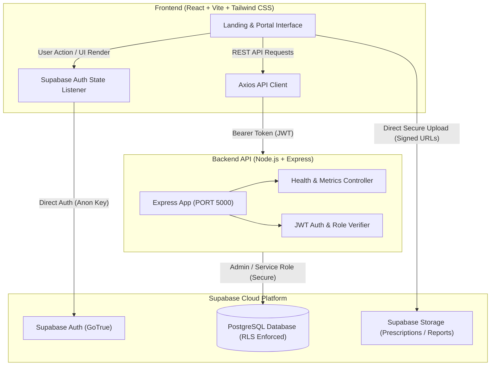

# CARECONNECT Architecture Specification

## 1. System Overview

**CARECONNECT** is an integrated healthcare management platform connecting Patients, Medical Practitioners (Doctors), and Healthcare Facilities (Hospitals). 

Tagline: **"Connecting Care. Saving Lives."**

## 2. Technology Stack

- **Client (`/client`)**:
  - React 19 + Vite
  - Tailwind CSS for modern, accessible healthcare design
  - Lucide Icons for clinical & portal iconography
  - `@supabase/supabase-js` for Auth sessions & Realtime
  - `axios` for structured REST API communication with interceptors

- **Server (`/server`)**:
  - Node.js (v20+) + Express
  - CORS, JSON Body Parser, Error Middleware
  - `@supabase/supabase-js` for backend administrative queries
  - Dynamic health check (`/api/health`, `/api/ping`)

- **Database & Identity (Supabase)**:
  - PostgreSQL with Row Level Security (RLS) enabled on all tables
  - Supabase Auth (JWT based session management)
  - Supabase Storage (Encrypted medical records, scans, prescriptions)

## 3. Security Principles

1. **Zero Secret Leakage**:
   - The `SUPABASE_SERVICE_ROLE_KEY` is NEVER exposed to the client or committed to source control.
   - Frontend strictly consumes `VITE_SUPABASE_URL` and `VITE_SUPABASE_ANON_KEY`.
2. **Row Level Security (RLS)**:
   - Data access is restricted at the PostgreSQL layer based on `auth.uid()` and verified role (`patient`, `doctor`, `hospital_admin`).
3. **No Real Patient Data**:
   - Only synthetic / mock medical data is used during development and testing.
4. **Environment Isolation**:
   - Development, staging, and production utilize isolated environment variables and Supabase projects.

